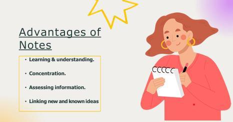

# 02 · Collaboration, Listening, Oral and Reading Skills

> Study focus: work productively with others, listen for meaning, take useful notes, and communicate ideas aloud and in writing. Based on Lesson 2 and the CCS 101 course outline.

## 1. Collaboration: make shared work visible

**Collaboration** is two or more people working together toward a shared task or goal. It can support teamwork, communication, innovation, and effective delivery when members contribute and coordinate.

### A simple group-work cycle

1. **Agree on the outcome:** turn the assignment into a clear shared goal.
2. **Plan the work:** break it into tasks, owners, and realistic deadlines.
3. **Share information:** listen, contribute evidence, and keep notes of decisions.
4. **Check progress:** ask what is complete, what is blocked, and who needs help.
5. **Combine and review:** check that the parts fit together and represent the group’s agreed work.
6. **Reflect:** identify what helped the group and what to change next time.

**Example:** For a short research presentation, members can agree on the question, assign source-finding and slide tasks, set a merge deadline, and rehearse together. A named owner and due date make each task trackable.

### Collaboration checklist

- [ ] Goal, roles, and deadlines are understood by everyone.
- [ ] Each member has a meaningful contribution.
- [ ] Decisions and sources are recorded and shared.
- [ ] Disagreement is about ideas and evidence, not personal attacks.
- [ ] The final work is reviewed as one coherent product.

## 2. Listening is active meaning-making

**Hearing** is receiving sound. **Listening** is the deliberate process of attending to, interpreting, evaluating, and responding to a message. Listening supports learning, memory, relationships, and fewer misunderstandings.

Listening can serve different purposes:

- **Active:** focus on the speaker and show attention through relevant feedback.
- **Reflective:** restate or paraphrase the meaning to check understanding.
- **Critical:** examine reasons and evidence before accepting a claim.
- **Empathic:** attend to the speaker’s feelings and perspective.
- **Enjoyment:** listen for appreciation or pleasure.
- **Passive:** receive sound with little active engagement; important details can be missed.

These are useful modes, not a single ranking. Choose the mode that fits the purpose.

### Listen in four moves

1. **Prepare:** reduce distractions and notice your purpose.
2. **Attend:** let the speaker finish; observe words and relevant non-verbal cues.
3. **Check meaning:** ask an open or clarifying question; paraphrase important points.
4. **Respond:** give a relevant answer or record key ideas.

**Example:** “So the proposal is due Friday, and you want feedback on the outline by Wednesday—is that right?” This paraphrase checks two details before action.

Common barriers include environmental noise, stress or anger, tiredness or hearing difficulty, and unfamiliar terms or jargon. Reduce distractions where possible, manage your state, ask for a term to be explained, and request repetition or another channel when needed.

## 3. Take notes that help you retrieve ideas

Capture **main ideas, supporting details, examples, questions, and source information**—not every sentence. Record the date, topic, and presenter/source when relevant. Use abbreviations and symbols consistently, then expand anything unclear soon after the session.

| Format | Best use | How it works |
|---|---|---|
| Cornell | Lecture or reading with later review | Main notes on one side, cue questions on the other, brief summary below |
| Outline | Hierarchical material | Indent supporting points under main ideas |
| Charting | Comparing repeated categories | Use columns for categories such as claim, evidence, and example |
| Mind map | Showing relationships | Put the central topic in the middle and connect related branches |

After a lecture, compare notes with a classmate to identify gaps, but verify details against the source rather than copying errors.

## 4. Oral skills: plan, deliver, respond

An oral presentation is easier to follow when one clear purpose guides the structure.

1. **Plan:** identify audience, purpose, time limit, and key message.
2. **Organize:** introduce the topic and main point; develop a few logically ordered points with examples; conclude by summarizing or stating the next step.
3. **Prepare:** rehearse aloud, check timing, and make any visual aid readable and relevant.
4. **Deliver:** use an audible pace and clear wording; look up from notes; use gestures naturally.
5. **Respond:** listen to questions fully, clarify if needed, and answer directly. If unsure, say so and identify how you would verify the point.

**Example outline:** *Purpose: explain a library search strategy.* Opening: present the research question. Body: show keywords, filters, and source checks. Close: summarize the search and ask for questions.

## 5. Reading for purpose

- **Preview** headings, introductions, conclusions, diagrams, and layout to see how a text is organized.
- **Set a question** that tells you what information to locate.
- **Read actively:** identify the main claim, supporting reasons, definitions, and evidence.
- **Check meaning:** pause to explain a paragraph in your own words; mark unfamiliar terms to verify.
- **Review:** summarize the argument and note questions or useful quotations with page details.

Skimming gives an overview; scanning searches for a particular item. Neither replaces close reading when you must evaluate an argument or use evidence.

### Active practice

Listen to a short course explanation and take outline notes. Close the source and give a one-minute summary from memory. Then check your notes: mark one main idea, two supporting details, one question, and any missed or misheard point.

### Common pitfalls

- Interrupting or planning your reply while the other person is still speaking.
- Treating group participation as task division only, with no coordination or shared review.
- Writing a transcript instead of notes that distinguish main ideas from examples.
- Treating skimming as enough to evaluate evidence or prepare an argument.
- Reading slides aloud rather than explaining their meaning to the audience.
